<div align="center">


# StyrixPlayer

**A music player for Android that follows the colors of what you listen to.**

Local library and YouTube Music, word-by-word synced lyrics, and a player that repaints itself from the cover art or the playing video.

[](../../releases/latest)
[](../../releases)
[](../../stargazers)
[](../../commits)
[](LICENSE)


[**Download**](../../releases/latest) &nbsp;·&nbsp; [Features](#features) &nbsp;·&nbsp; [Screenshots](#screenshots) &nbsp;·&nbsp; [Build](#build-from-source) &nbsp;·&nbsp; [Report a bug](../../issues/new) &nbsp;·&nbsp; [Changelog](CHANGELOG.md)

</div>

---

## Screenshots

The whole app repaints itself from the cover that is playing.

<div align="center">
<table>
  <tr>
    <td align="center">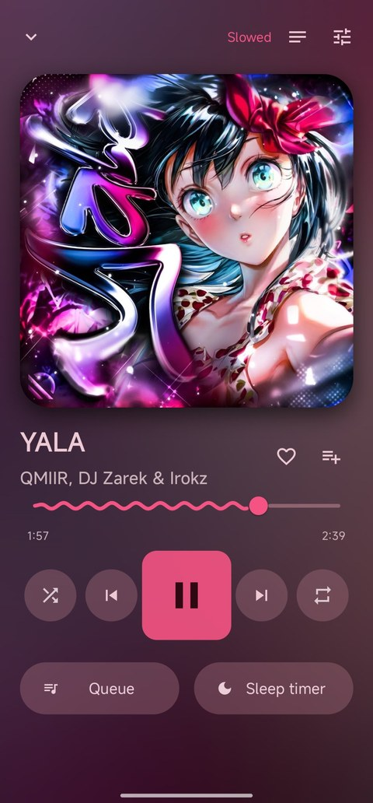</td>
    <td align="center">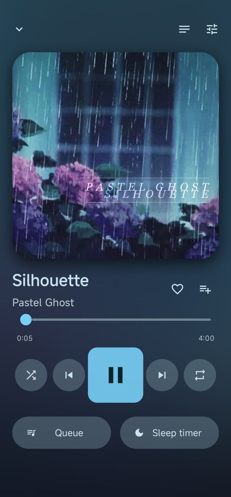</td>
    <td align="center">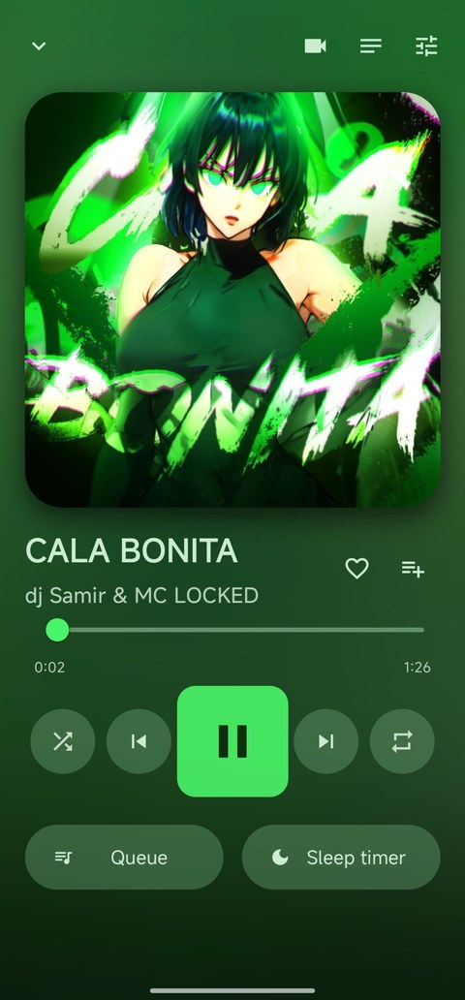</td>
  </tr>
</table>

<table>
  <tr>
    <td align="center">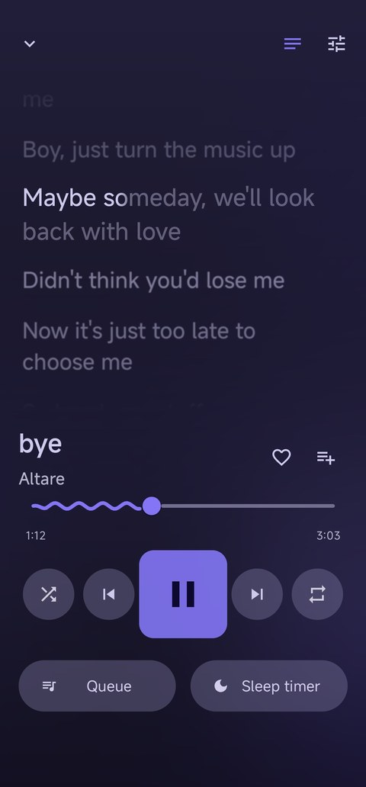<br/><sub><b>Synced lyrics</b><br/>word by word</sub></td>
    <td align="center">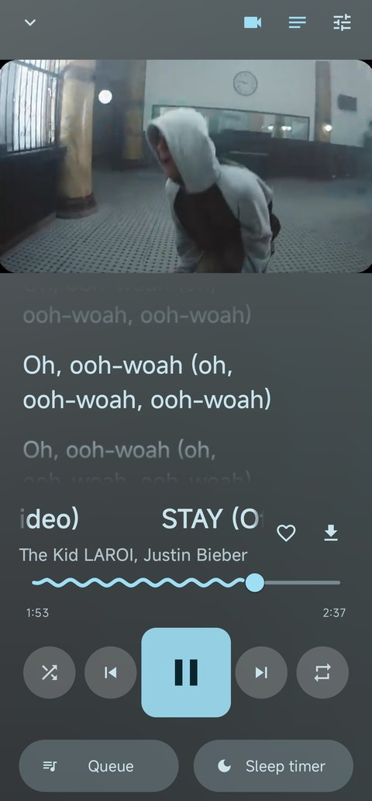<br/><sub><b>Video mode</b><br/>video on top, lyrics below</sub></td>
    <td align="center">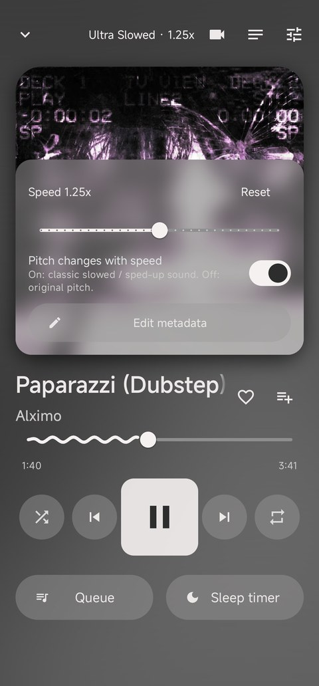<br/><sub><b>Speed and pitch</b><br/>frosted glass panel</sub></td>
  </tr>
</table>

<table>
  <tr>
    <td align="center">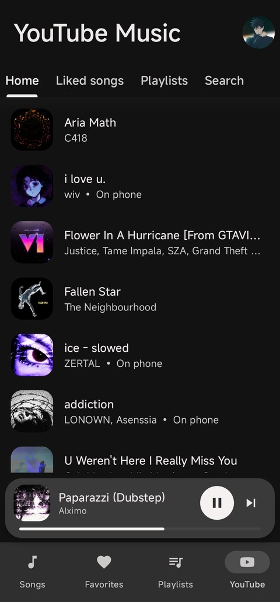<br/><sub><b>YouTube Music</b></sub></td>
    <td align="center">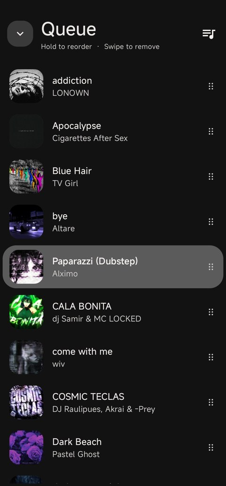<br/><sub><b>Queue</b></sub></td>
    <td align="center">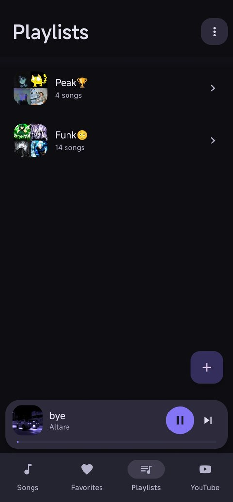<br/><sub><b>Playlists</b></sub></td>
    <td align="center">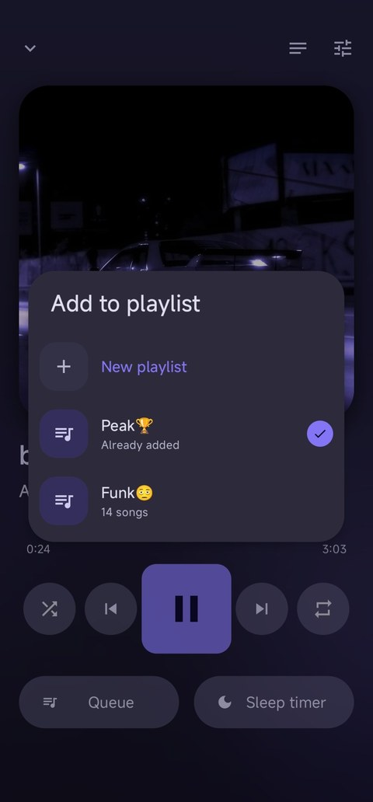<br/><sub><b>Add to playlist</b></sub></td>
    <td align="center">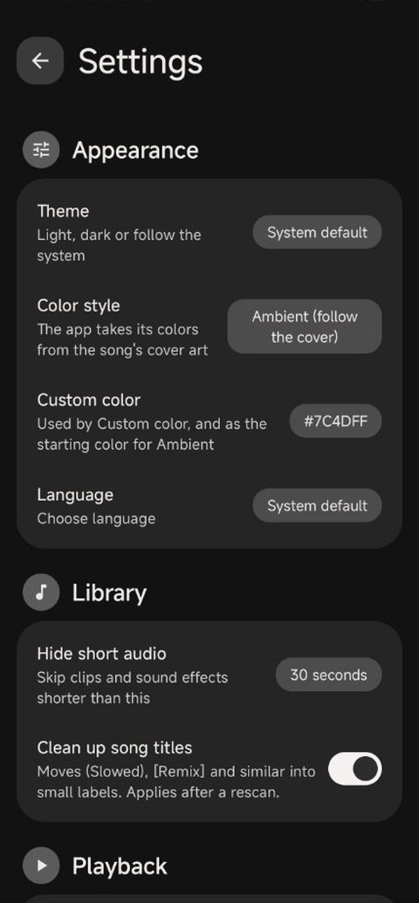<br/><sub><b>Settings</b></sub></td>
  </tr>
</table>
</div>

## Features

### 🎵 Playback
- Local library with songs, albums, artists, playlists and favorites
- YouTube Music: search, stream and queue, with a signed-in account
- Speed and pitch control, sleep timer, shuffle and repeat
- Music cache so streamed songs replay instantly, even offline
- Video mode for streamed songs: the video runs edge to edge on top, with the lyrics (or the cover) below

### 🎤 Lyrics
- Synced lyrics from LyricsPlus, BiniLyrics and LRCLIB, picked automatically or chosen by you
- Word-by-word highlighting that glides with the singer, plus a per-song timing offset

### 🎨 Ambient look
- The background is a smooth color mesh taken from the cover, or live from the video as it plays
- Buttons and panels are frosted glass tinted by the colors behind them
- A wavy seek bar that rolls while music plays and settles flat when you pause
- A "most listened" bar above the seek bar shows which parts of a song you replay

### ⬇️ Downloads and tags
- Download YouTube **audio** to `Music/StyrixPlayer` with the cover and tags written into the file
- Download YouTube **video** to `Movies/StyrixPlayer`, with a choice of quality (up to 1080p)
- One download queue, a progress ring on the download button, and a notification that keeps up
- Songs already on your phone are played from the file and never looked up online
- Tag editor with online lookup (iTunes and Deezer) and cover picking

### 🌍 Everything else
- Arabic, Kurdish (Sorani) and Turkish, with right-to-left layout
- Built-in update check that downloads and installs new releases
- Crash report you can copy after a crash

## Install

1. Open the [latest release](../../releases/latest) and download the `.apk`.
2. Open it. Android asks once to allow installs from your browser or file manager.
3. Done. From then on the app tells you when a newer release is out.

Requires **Android 8.0** or newer.

## Build from source

```bash
git clone https://github.com/hamoexe/StyrixPlayer.git
cd StyrixPlayer
./gradlew assembleDebug
```

One `app` module. Main dependencies: AndroidX **media3** for playback, **NewPipeExtractor** for YouTube, and **Material Components**.

Release builds are signed with a private key that is not part of this repository, so updates only install over builds signed with the same key.

<details>
<summary><b>Releasing an update</b></summary>

<br/>

The in-app updater reads the newest release of this repository. To ship a version:

1. Bump `VERSION_NAME` and `VERSION_CODE` in `AppInfo.java` (`app/build.gradle` reads them from there).
2. Add an entry to [CHANGELOG.md](CHANGELOG.md).
3. Build and sign the APK.
4. Publish a GitHub release tagged `vX.Y.Z` with the APK attached, and paste the changelog entry into the notes. Users see it in the update dialog.

</details>

## Help and feedback

- 🐞 Found a bug? [Open an issue](../../issues/new). Include your Android version and what you tapped.
- 💡 Have an idea? [Open an issue](../../issues/new) and say what you would like to see.
- ⭐ Like it? Star the repo, it helps others find it.

## Star history

<div align="center">

[](https://star-history.com/#hamoexe/StyrixPlayer&Date)

</div>

## License

Copyright (C) 2026 hamoexe. Released under the [GNU GPL v3](LICENSE).

StyrixPlayer is free and will stay free. You can use it, study it and change it, but anyone who shares a copy or a modified version must also share its full source under the same license and keep this copyright notice, so credit always goes back to the author.

## Credits

[NewPipeExtractor](https://github.com/TeamNewPipe/NewPipeExtractor) for YouTube access, [LRCLIB](https://lrclib.net) and BiniLyrics for lyrics, and [AndroidX media3](https://developer.android.com/media/media3) for the player.

<div align="center">

<sub>Made with 💜 by <a href="https://github.com/hamoexe">hamoexe</a>, on a phone :)</sub>

</div>
